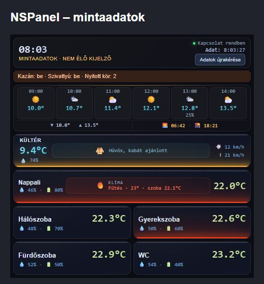

# NSPanel Node-RED dashboard

Egy 480×480 képpontra tervezett, UIBUILDER-alapú otthonfelügyeleti felület NSPanelhez és asztali böngészőhöz. A felület időjárást, klímaállapotot, hőmérséklet- és páratartalom-szenzorokat, fűtési köröket, világítást, redőnyöket és kapcsolatállapotot jelenít meg.

A projekt a UI forrását és a Node-RED oldali állapot-visszaküldő javítást külön őrzi a teljes HVAC flow-tól. Minden személynév és belső hálózati cím semleges mintára lett cserélve.



## Fő képességek

- reszponzív, 480×480-ra optimalizált, sötét „glass” felület;
- időjárás, előrejelzés, klíma, szobaszenzorok és fűtési állapot;
- kazán–szivattyú összesítés és offline/elavult adatjelzés;
- világítási és redőnyállapotok;
- induláskori, újracsatlakozási és kézi állapotlekérés;
- legfeljebb 24 órás böngésző-cache egyértelmű „Mentett adat” jelöléssel;
- hibás számértékek, rövidülő előrejelzés és hiányzó UIBUILDER-kliens kezelése;
- socketre célzott replay, amely nem indít eszközparancsot és nem hoz létre visszacsatolási hurkot.

## Tartalom

```text
src/
  index.html              tényleges UIBUILDER oldal
  index.css               megjelenés
  index.js                klienslogika
  ui-flow-patch.json      részleges Node-RED export
  unifier-function.js     állapot-összesítő Function törzs
  replay-function.js      socketre célzott visszaküldés
  preview.html            önálló látványterv mintaadatokkal
  ELLENORZES.txt          szimulált ellenőrzések eredménye
assets/
  UI-elonezet.jpg         képernyőkép mintaadatokkal
docs/
  INSTALLATION_HU.md
  DATA_CONTRACT_HU.md
```

## Gyors előnézet

A `src/preview.html` önálló fájl, Node-RED nélkül megnyitható. Mintaadatokat használ, nem csatlakozik eszközökhöz.

## Telepítés röviden

1. Mentsd el a jelenlegi flow-t és az UIBUILDER `src` könyvtárát.
2. Cseréld a meglévő Unifier Function törzsét a `src/unifier-function.js` tartalmára.
3. Mindkét UIBUILDER node-hoz adj külön replay Function node-ot a `src/replay-function.js` tartalmával.
4. Másold az `index.html`, `index.css` és `index.js` fájlokat a használt UIBUILDER példány `src` könyvtárába.
5. Deploy, majd cache-t megkerülő újratöltés után végezd el a helyszíni próbákat.

A pontos bekötés: [INSTALLATION_HU.md](docs/INSTALLATION_HU.md).

## Kompatibilitás

Az eredeti export UIBUILDER 7.7.4-et használt. A patch az alábbi URL-ekkel számol:

- `nscompact` – panelnézet;
- `nsdesktop2` – asztali nézet.

Más URL vagy node-azonosító esetén a részleges export automatikus importja helyett a kézi telepítés ajánlott.

## Korlátok

- A csomag nem tartalmaz kioszkböngésző- vagy NSPanel-firmware-konfigurációt.
- Ha a panel az iHost/Node-RED elindulása előtt nem tudja magát az oldalt betölteni, a kliensoldali reconnect csak az oldal sikeres betöltése után tud működni.
- A frissességi idő az adat Node-RED-be érkezését jelzi, nem bizonyítja, hogy a fizikai mérés ugyanakkor történt.
- A UI nem helyettesíti a HVAC vezérlés és a fizikai gépészet biztonsági ellenőrzését.

## Licenc

A repository jelenleg nem ad külön nyílt forráskódú licencet. A kód megtekinthető és archiválási céllal közzétett; újrafelhasználáshoz a tulajdonos engedélye szükséges.
